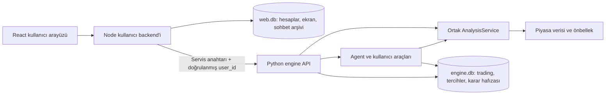

# trader-agent

Borsa İstanbul için Türkçe, kullanıcı hesaplarına ayrılmış karar destek ve portföy takip uygulaması.
İş Yatırım piyasa verisini, deterministik teknik hesapları, kayıtlı haber özetlerini
ve Claude tabanlı sohbeti aynı çalışma alanında birleştirir. Seans içi, haftalık ve
1–3 aylık planları kullanıcının vade ve risk tercihine göre değerlendirir.
Portföy işlemleri kullanıcı kayıtlarıdır; uygulama aracı kuruma emir göndermez.

Web arayüzünde kullanıcı adı/parola ile giriş ve basit kayıt, genel bakış, kullanıcıya
özel en fazla 10 hisselik takip listesi, hisse grafikleri, portföy ve kalıcı sohbet
geçmişi bulunur. Sol menü daraltıldığında gezinme ikonları görünür kalır. Orta alandaki
Tercihler sayfasında işlem vadesi, risk seviyesi ve piyasa kartları seçilir. Sohbetin
sol kenarı sürüklenerek iki yöne boyutlandırılır; klavyede ok tuşları, Home ve End de
kullanılabilir. Mobilde sohbet tam ekran açılır.

## Mimari

Python engine piyasa verisini, deterministik analizleri ve kullanıcıya bağlı trading
verilerini yönetir. `userui/` altındaki React arayüzünün ayrı Node backend'i hesap, giriş oturumu,
ekran düzeni ve tam sohbet arşivini yönetir. İki backend aynı veritabanını açmaz.
`open_runtime()` ortak piyasa/analiz servislerini bir kez oluşturur; kullanıcıya
bağlı repository ve araçları composition root'ta bağlar.



Sürekli öğrenen mekanizma bu fazda çalıştırılmaz. Sonraki fazda kendi worker
yaşam döngüsü, kurallar/model sürümleri veritabanı ve ayrı admin API/paneli olan
bir uygulama olarak eklenmelidir. `engine/analysis/` içindeki saf günlük, seans,
risk ve portföy hesapları UI/agent/runtime bağımlılığı olmadan tekrar kullanılabilir;
`AnalysisService` veri erişimini bu hesaplardan ayırır. Öğrenen süreç kullanıcı
web veritabanını kullanmaz. Böylece modellerin eğitimi ve izlenmesi kullanıcı
sohbetinin veya web sunucusunun çalışmasına bağlı olmaz.

| Konum | Sorumluluk ve temel bileşenlerin amacı |
| --- | --- |
| `src/trader_agent/main.py`, `env.py` | CLI komutlarını yönlendirmek; ortamı ve dizin ayarlarını yüklemek. |
| `config/` | YAML ayarlarını okumak ve doğrulamak; runtime bileşenleri oluşturmaz. |
| `client/` | `EngineClient` ile bakım işlerini çalışan engine'e HTTP üzerinden iletmek. |
| `utils/` | Ortak loglama ve saat dilimi dönüşümleri. |
| `engine/runtime.py`, `api.py` | Servis yaşam döngüsü, oturumlar, HTTP sınırı ve erişim kontrolü. |
| `engine/web.py` | `WebService` ile arayüz için JSON görünümleri ve takip listesi yenilemesi. |
| `engine/agent/` | `AgentRunner` ile model/araç döngüsü; `ConversationMemory` ile oturuma özel özet, tercihler ve son konuşmalar. |
| `engine/analysis/` | `AnalysisService` ile ortak veri alma akışı; saf fonksiyonlarla günlük/seans analizi, işlem riski ve portföy toplamları. |
| `engine/calendar/` | `TradingCalendar` ile seans/tatil kuralları; `TradingDay` ile günün açık, kapalı veya bilinmeyen durumunu ve gerekçesini taşımak. |
| `engine/marketdata/` | `IsYatirimProvider` ile kaynak erişimi; `MarketService` ile önbellek, tamamlanmış bar ve ortak fiyat seçimi. |
| `engine/repository/` | Kullanıcıya bağlı portföy, takip listesi, trading tercihleri, karar hafızası ve ortak haber özetlerinin SQLite kalıcılığı. |
| `engine/tools/` | Servisleri modelin çağırabileceği, girdileri doğrulanan araçlara uyarlamak. |
| `engine/news/` | `NewsService` ile RSS alma, şirket eşleştirme, LLM özeti ve atomik kayıt. |
| `engine/jobs/` | Takip listesinin günlük piyasa verisini ortak önbelleğe önceden yüklemek. |
| `userui/src/`, `userui/backend/`, `userui/server.mjs`, `tests/` | React UI; Node HTTP sınırı; ayrı worker üzerinde SQLite/parola işlemleri; Python davranış testleri ve ayrı canlı entegrasyon testleri. Web testleri `userui/tests/` içindedir. |

Tablodaki Python paketleri `src/trader_agent/` altındadır. Sınıfların ayrıntılı
amacı kod içindeki açıklamalarda, HTTP sözleşmeleri engine'in `/docs` ve
`/openapi.json` çıktılarındadır. Sohbet yanıtı NDJSON `text`, `tool` ve `error`
olaylarından; web yanıtları JSON görünümlerinden oluşur.

## Analiz ve agent davranışı

Agent gerektiğinde `scan(horizon)` → `analyze(symbols, horizon)` →
`evaluate_trade(...)` akışını kullanır. Tarama, detay ve web aynı vade için aynı
miktarda tamamlanmış günlük geçmişle hesap yapar.

| Vade | Plan süresi | Günlük EMA | İstenen geçmiş |
| --- | --- | --- | --- |
| `intraday` | Aynı seans | 9 / 21 | 105 seans |
| `swing` | Günler–haftalar | 20 / 50 | 250 seans |
| `position` | 1–3 ay | 20 / 60 | 300 seans |

Hesaplar EMA konumu/hizalaması, Wilder RSI14 ve ATR14/ATR%, 5/20/60 seans getirileri,
son seans ve dönem fiyat aralıkları ile günlük göreli hacimdir. RSI/ATR son 100
seansta, göreli hacim son hacmin önceki 20 seans ortalamasına oranıyla hesaplanır.
Referans aralıkları son tamamlanmış seansı içerir; doğrulanmış destek/direnç değildir.
Eksik hesap `None` ve nedeni ile döner. Saf hesaplar I/O veya sistem saati kullanmaz.

`evaluate_trade` yeni long planında `stop < giriş < hedef` kuralını uygular;
R/R, risk ve verilen risk/nakit bütçesine göre tam lot üst sınırını hesaplar.
Maliyet açıkça verilirse net oran da üretilir; bilinmeyen bütçe veya maliyet
uydurulmaz. Stop mesafesi planlanan risktir, azami gerçekleşen kayıp garantisi değildir.

Risk seviyesi (`RiskLevel` / `risk_level`) `low`, `moderate` veya `high` olabilir; belirtilmediyse bilinmeyen
kalır. Tercihler sayfasındaki vade ve risk seçimleri her an değiştirilebilir; seçim bir sonraki
mesajda uygulanır, devam eden yanıtın bağlamını değiştirmez. Mesajda açıkça istenen
tek işlem senaryosu o değerlendirmede önceliklidir; sohbet seçimini değiştirmez.
Risk seviyesi hesapları değil planın yorumunu
etkiler. Evrensel minimum R/R, zorunlu AL kararı veya seans dışında plan yasağı
yoktur. Parametreler başlangıç seçimleridir; backtest ile doğrulanmış strateji değildir.

Asistan her mesajda borsa saat dilimindeki güncel tarih ve saati alır. Analizde
`as_of` fiyatın, `observed_at` sorgunun zamanıdır; `price_age_minutes` aradaki
süredir. `delay_minutes` sağlayıcının seans içi yayın gecikmesidir. Önceki günün
kapanışı bu gecikmeyle etiketlenmez; seans öncesinde son tamamlanmış kapanış
beklenen referanstır, eksik gün kontrolü ayrıca `daily_stale` ile yapılır.

Ana model yanıtı ve araç kullanımı yönetir; yardımcı model yapılandırılmış
hafızayı günceller. Model ve prompt ayarları kodla birlikte sürümlenir. Bir tur
en fazla 10 ana model çağrısı yapar; çıktı token sınırı ve varsayılan 180 saniyelik
toplam süre sınırı vardır. Hafıza çıktısı doğrulanmadan state değiştirilmez.
Şema hatasında aynı tur süresi içinde bir kez düzeltme istenir; yeniden geçersiz
çıkarsa önceki geçerli hafıza korunur ve hata bildirilir. Portföy yazmaları bu
düzeltme sırasında tekrarlanmaz.
Model ve token/cache kullanımı loglanır; parasal maliyet ayrıca hesaplanmaz.

Tam mesaj geçmişi `web.db` içinde `user_id` ile sahiplenilen sohbetlerde saklanır.
Yeni sohbet eski arşivi veya trading tercihlerini silmez. Her kullanıcı mesajı
zamanı ve gönderim anındaki tercih kopyasıyla saklanır. Sohbet seçimi ve arşivi
başka kullanıcı tarafından okunamaz; browser'ın gönderdiği kullanıcı/sohbet kimliği
engine'e doğrudan geçirilmez. Aktif sohbeti web backend'i belirler.

Engine'in sınırlı karar hafızası (state/özet ve son iki tur) `engine.db` içinde
kullanıcıyla adlandırılan oturuma kaydedilir; restart sonrası geri yüklenir.
Piyasa önbelleği bellektedir. Kesilen yanıtlar hata bilgisiyle arşivlenir; süreç
zorla sonlandırılırsa henüz tamamlanmamış yanıtın metni kaybolabilir. Aynı süreçte
tekrarlanan yarım tur için işlem tekilleştirmesi bulunur; süreçler arası kalıcı
işlem idempotency garantisi yoktur.

Vade, günlük EMA dönemlerini ve gösterilen 5/20/60 seans getirisini belirler.
Düşük riskte oynaklık (ATR) öne alınır; yüksek riskte RSI ve göreli hacim öne
alınır. Risk seçimi formülleri veya fiyatları değiştirmez. Grafik aralığı ayrı bir
seçimdir. Piyasa kartları Tercihler sayfasından seçilir: BIST 100, BIST 20, USD/TL, EUR/TL,
Brent petrol, ons altın, Bitcoin, ABD 10Y/2Y ve Türkiye 10Y/2Y. Bu fazda veri
kaynağı bağlı değildir; fiyat/değişim `null` gelir ve “Veri bekleniyor” gösterilir.
Kartlarda grafik veya temsili fiyat bulunmaz.

## Piyasa verisi ve seans takvimi

Kaynak 15 dakika gecikmelidir; fiyat zamanı, seans tarihi ve veri kalitesi
sonuçlarda gösterilir. Gün içi veri hacimsiz fiyat örnekleridir. M5/M15 çizgi
grafikleri bu örneklerden üretilir; bu aralıklarda indikatör hesaplanmaz.
Günlük mum yalnız gerçek tam OHLC varsa çizilir; eksik OHLC'de kapanış çizgisi
kullanılır. Grafik aralığı analiz vadesinden bağımsızdır.

`ohlc_kind`, raporlanan OHLC (`reported`), açılışı eksik gerçek aralık
(`range_only`), örneklenen fiyatlar (`sampled`) ve yalnız kapanış
(`close_only`) ayrımını taşır. ATR ve günlük yüksek/düşük hesapları yalnız gerçek
aralıklardan üretilir. Eksik fiyatlar sıfır veya başarılı veri gibi sunulmaz.

Haftalık düzen [market.yaml](configs/market.yaml), tarihli istisnalar
[calendar.json](data/calendar.json) içindedir. `close` sürekli işlemin,
`daily_close` kapanış işlemlerinin bitişidir. Günlük bar ancak kapanış işlemleri
ve kaynak gecikmesi geçince tamamlanmış sayılır. `TradingSession` bu sınırları
ayırır; provider, agent ve web aynı takvimi kullanır.

Takvim 2025–2027 kapsamını içerir; 2027 kayıtları BIST'in resmî tablosuyla ayrıca
karşılaştırılmalıdır. Yeni yıl eklenirken tatiller ve `covered_years` birlikte
güncellenir. Kapsam dışında seans `unknown` olur; gün içi erişim hata verir.
Günlük geçmiş haftalık düzenle okunabilir, fakat kapsam dışı tatil doğruluğu garanti
edilmez. Takvim başlangıçta yüklenir; değişiklik için engine yeniden başlatılır.
Tatil/hafta sonunda son tamamlanan günlük kapanış kullanılır; seans sonrası
günün gecikmeli özeti, günlük kapanış yayımlanana kadar kullanılabilir.

## Kalıcı veri ve haberler

`data/engine.db` trading ve ortak piyasa/haber kalıcılığına aittir.
`web.db` hesapları (scrypt parola özeti), 12 saatlik iptal edilebilir giriş
oturumlarını, ekran tercihlerini ve sohbet arşivini tutar. Yerelde varsayılan
`data/web.db`, Compose'da ayrı `web-data` volume'üdür; `USERUI_DATABASE_PATH` ile
ayarlanabilir. Uygulama ve Docker servisi `userui` adını kullanır; mevcut
hesaplara erişimi korumak için veritabanı dosyası ve volume adları korunur.
SQLite/parola işlemleri web HTTP event loop'unu bloklamamak için
sınırlı kuyruklu worker'da yürütülür. Eksik tablolar başlangıçta oluşturulur.

Portföy ekranında **Önerilenler → Açık pozisyonlar → Kapanan pozisyonlar →
Performans** sekmeleri bulunur. Öneriler ile portföy kayıtları farklı yaşam
sürelerine sahiptir; önerilerin başarısı ölçülmez.

- Somut asistan planı `publish_recommendation` aracından geçerek sohbet kartına
  ve Önerilenler'e eklenir. Genel yorumlar otomatik öneriye çevrilmez. Gelecekteki
  bağımsız model üreticisi aynı doğrulamaları kullanan, engine anahtarıyla korunan
  `POST /v1/web/recommendations` girişinden beslenebilir; kullanıcı proxy'si bu
  yayınlama girişini açmaz. Sürekli öğrenen model ve admin paneli henüz yoktur.
- Öneriler borsa saat diliminde gün sonunda; seans içi öneriler ilgili seansın
  sonunda pasif olur. Temizlik işi beklemeden listeden kalkar; eski sohbet kartı
  süre dolduğunu gösterir. Arşiv satırları ve pozisyonun ilk planı korunur.
- **Portföye dahil et** yalnız lot ve giriş fiyatı ister. Fiyat önerilen aralıkta
  olmalıdır; süre, aralık ve kullanıcı sahipliği engine'de transaction içinde
  yeniden denetlenir. Aynı öneri bir kullanıcıda yalnız bir pozisyon oluşturur.
  Yazma isteklerindeki `operation_id`, tekrar gönderimde ikinci hareketi önler.
- Manuel ekleme hisse, lot, fiyat ve vade ister; stop, hedef, tarih ve not isteğe
  bağlıdır. Bilinmeyen başlangıç tarihi için tutma süresi uydurulmaz. Aynı hissede
  farklı kaynak ve planlarla birden fazla pozisyon tutulabilir. Ek alım, kapatma
  ve plan güncelleme sembolle değil `position_id` ile belirli kayda uygulanır.
- `positions` kaynak (`manual`/`system`), üretici, öneri bağı ve değişmez ilk planı;
  `position_transactions` miktar hareketlerini; `position_plans` plan değişikliklerini
  tutar. Planı düzenlemek kaynağı değiştirmez. Öneri kaynaklı pozisyona ek alımda
  da ilk önerinin aralığı ve geçerlilik süresi uygulanır.
- Kısmi ve tam kapatmalar ağırlıklı maliyetle hesaplanır. Tam kapanış geçmişi
  korur; sonraki bağımsız ekleme yeni pozisyon açar. Portföy temizleme geçmişteki
  kapanan kayıtları silmez. Emir iletimi veya gerçek hesap bağlantısı yoktur.
- Performans **Tümü / Sistem önerileri / Manuel** olarak filtrelenir. Dönem
  gerçekleşen kapatma hareketlerine uygulanır; kısmi kapatmalar kâr/zarara girer.
  Başarı oranı ve ortalama tutma süresi yalnız tamamen kapanmış pozisyonlardan
  hesaplanır. Getiri yüzdesi gerçekleşen kârın kapatılan maliyete oranıdır;
  nakit akışına göre hesap getirisi değildir. Açık pozisyonların güncel değeri
  ayrıca gösterilir. Komisyon, vergi ve temettü hesaba katılmaz.
- Pozisyon asistanla incelenirken kendi kayıtlı vadesi kullanılır; kullanıcının
  tercih değişikliği kayıtlı planı değiştirmez. Hesaplar `engine/positions.py` ve
  `engine/analysis/portfolio.py` içinde I/O'dan bağımsızdır.
- Portföy özeti değer, gerçekleşmemiş kâr/zarar, yoğunlaşma ve güncel fiyatlardan
  stoplara brüt düşüş tutarını verir. Eksik fiyat/stop veya aşılmış stop nedeniyle
  hesaplanamayan toplamlar bilinmeyen kalır. Nakit ve toplam hesap varlığı izlenmez.
- Seçilebilir hisseler `data/stocklist.json`, takip edilenler `watchlist`
  tablosunda kullanıcı bazında tutulur. Yeni hesap boş listeyle başlar.
  En fazla 10 farklı hisse kuralı transaction içinde denetlenir; tekrar eklemek
  ikinci kayıt oluşturmaz.
  Takipten çıkarma portföyü etkilemez.
- `news_digests`, RSS içeriklerinden üretilen piyasa ve şirket özetlerini tutar.
  Kaynaklar [news.yaml](configs/news.yaml) içindedir. Şirketler sembol/ad ile
  eşleştirilir; şirket özeti yalnız takip edilenler için üretilir.

Önceki tek kullanıcılı `data/data.db` dosyası değiştirilmez ve otomatik taşınmaz.
Yeni kullanıcı sahipliği sözleşmesi `engine.db` ile başlar. Eski portföyleri yeni
hesaba aktarmak ayrı, kullanıcı eşleştirmesi gerektiren bir veri aktarımıdır;
uygulama eski işlemlere sahip uydurmaz. Çoklu pozisyon şeması da önceki
`engine.db` şemasıyla uyumlu değildir. Bu geliştirme ortamında kullanıcı onayıyla
engine veritabanı sıfırlanmıştır; uygulama kendiliğinden migration veya veri silme
yapmaz. Başka ortamda mevcut dosya varsa yeni şemayı kullanmadan önce açık veri
aktarımı veya sıfırlama kararı gerekir. Kullanıcı hesapları `web.db` içinde kalır;
sohbet kartlarının öneri kimlikleri `message_recommendations` tablosunda tutulur.

Haber yenileme ayrı bakım işidir; sayfa açılışı LLM veya RSS yenilemesi başlatmaz.
RSS geçmiş arşiv garantisi vermez. Bir yenilemenin tüm özetleri tek transaction
ile yazılır; hata veya ilgili haber bulunmaması mevcut kayıtları değiştirmez.
Aynı gün başarılı yenileme ilgili özetleri günceller. Sonuçtaki `omitted_items`,
girdi bütçesi nedeniyle dışarıda kalan haber sayısını gösterir. Agent mevcut
özetleri okuyabilir; haberlerden yeni otomatik işlem sinyali entegrasyonu yoktur.

## Kurulum ve çalıştırma

### Docker

Yeni kurulumda proje kökünde `.env.example` dosyasını `.env` olarak kopyalayın;
`ANTHROPIC_API_KEY` ve güçlü bir `ENGINE_API_KEY` değeri tanımlayın.
Web girişinde kullanıcı adı ve parola ile hesap oluşturun; ortak web parolası yoktur.

```sh
cp .env.example .env
docker compose up -d --build engine userui
```

Örnek ayarlarla arayüz http://127.0.0.1:3000 adresindedir. Compose engine hazır
olunca `userui` servisini başlatır; portları host üzerinde yalnız loopback'e açar.
`configs/`, `data/` ve `logs/` host'tan bağlanır. `/health` hazır olma kontrolüdür.
Önceki `web` servisi Docker'da çalışıyorsa aynı `up` komutuna `--remove-orphans`
ekleyerek eski servis container'ını kaldırın; kayıtların bulunduğu `web-data`
volume'ü yeni `userui` servisi tarafından kullanılmaya devam eder.

### Yerel geliştirme

Python 3.14+ ve Node.js 22.13+ gerekir. Aynı `.env` hazırlığından sonra:

```sh
python3 -m venv .venv
source .venv/bin/activate
python -m pip install -e '.[dev]'
trader-agent engine
```

Başka terminalde kullanıcı arayüzü sunucusunu başlatın:

```sh
cd userui
npm ci
npm run build
npm start
```

Arayüz geliştirmek için Node sunucusu açıkken üçüncü terminalde `userui/` içinde
`npm run dev` çalıştırın. Vite http://127.0.0.1:5173 adresinden API isteklerini
Node sunucusuna iletir. Grafikler TradingView Lightweight Charts kullanır;
telif bildirimi `userui/public/NOTICE.txt` içindedir ve web'de `/NOTICE.txt` ile sunulur.

### Yapılandırma

| Kaynak | İçerik |
| --- | --- |
| `.env` / ortam | API anahtarları, web veritabanı yolu, adresler, portlar ve dizinler. Örnekler [.env.example](.env.example) içinde. |
| `configs/llm.yaml` | Ana/yardımcı model, `agent_effort`, çıktı token sınırı ve isteğe bağlı `turn_timeout`. |
| `configs/market.yaml` | Borsa, saat dilimi, haftalık seans, stocklist ve takvim dosya adları. |
| `configs/news.yaml` | RSS kaynakları, timeout, eşzamanlılık ve özet girdi/çıktı sınırları. |

Python giriş noktası çalışma dizinindeki `.env` dosyasını okur; ortam değişkenleri
önceliklidir. Alternatif dosya `trader-agent --env-file /proje/.env engine` ile
seçilir. Göreli config/veri/log dizinleri seçilen dosyanın konumuna göre çözülür.
YAML dosyaları eksik veya geçersizse başlangıç durur; otomatik üretilmez.

`ENGINE_HOST/PORT` dinleme adresini, `ENGINE_URL` client ve web bağlantısını
belirler; port değişince URL de güncellenmelidir. Compose bağlantıyı kendi ağında
kurar. `npm start` kökteki `.env` dosyasını okur; başka dosya için `userui/` içinde
`node --env-file=/proje/.env server.mjs` kullanılabilir.

Dış erişimde HTTPS reverse proxy ve `USERUI_ORIGIN` tanımlayın; sohbet akışı için
proxy buffering kapalı olmalıdır. Web backend'i için `ENGINE_API_KEY` zorunludur.
Engine, kullanıcı başlığını yalnız servis anahtarı yapılandırıldığında kabul eder;
proxy kimliği HttpOnly/SameSite cookie ile doğrulanmış hesaptan üretir ve tarayıcı
başlıklarını upstream'e taşımaz. Engine doğrudan internete açılmamalıdır.
Anahtarlar tarayıcıya aktarılmaz. Kayıt/giriş denemeleri hız sınırına tabidir.
Hesaplar, giriş oturumları, sohbetler ve tercihler restart sonrası korunur.

## Bakım işleri

```sh
docker compose exec -T engine trader-agent prefetch-market
docker compose exec -T engine trader-agent daily-digest --since=24h
```

Yerelde aynı komutları `trader-agent prefetch-market` ve
`trader-agent daily-digest --since=24h` şeklinde çalıştırın. Komutlar `ENGINE_URL`
üzerinden çalışan engine'e bağlanır. Ön yükleme tüm kullanıcıların takip listelerinin birleşiminden günlük geçmişi
paylaşılan önbelleğe alır; haber işi RSS/özet yenilemesini yürütür. Zamanlama bu
komutların dışarıdan çağrılmasıyla yapılır. `--since` için `24h`, `7d` veya ISO
tarih verilebilir; belirtilmezse haber servisinin varsayılan aralığı kullanılır.

## Doğrulama

Aktif Python sanal ortamıyla proje kökünde:

```sh
python -m pytest -q
ruff check src tests
```

`userui/` dizininde:

```sh
npm test
npm run build
npx playwright install chromium
npm run test:e2e
```

Hızlı Python ve web testleri canlı ağ/LLM kullanmaz; tarayıcı testleri masaüstü ve
mobil akışları test verileriyle kontrol eder. Kurulu Chrome tercih edilirse E2E
komutuna `TRADER_BROWSER_PATH` ortam değişkeniyle çalıştırılabilir dosya yolu verilir.

Canlı sağlayıcı/model testleri `tests/integration/` içindedir ve varsayılan test
koşusundan dışlanır. Model testleri ücretli API çağrısı yapar. Vade/risk eval'ini
projenin `.env` yükleyicisiyle açıkça çalıştırmak için:

```sh
python - <<'PY'
import pytest
from trader_agent.env import load_env
load_env()
raise SystemExit(pytest.main([
    '-m', 'integration', 'tests/integration/test_agent_horizons.py',
]))
PY
```

Sürümlenen örnekler [horizon_eval.json](tests/fixtures/agent/horizon_eval.json)
ve [digest_eval.json](tests/fixtures/news/digest_eval.json) içindedir. Agent eval'i
vade/risk ayrımı, sohbet sırasında tercih değişimi, eski mesajın tercih bağlamı,
farklı vadeli pozisyonlar, geçici tercih, eksik veri, araç çıktısındaki talimat
girişimi ve RSI uç değerini kapsar. Başarı ölçütleri doğru araç/vade seçimi,
deterministik risk hesabı, sohbet seçiminin ve tarihsel bağlamın korunması,
izinsiz yazma olmaması ve veri
kısıtlarının belirtilmesidir. Haber eval'i sayısal olguların korunmasını ve
istenmeyen talimat çıktılarının bulunmamasını denetler. Prompt/model değişince
aynı örneklerle davranış karşılaştırılmalı; serbest metin ayrıca okunmalıdır.
Bu kontroller yatırım performansı veya kârlılık doğrulaması değildir.
